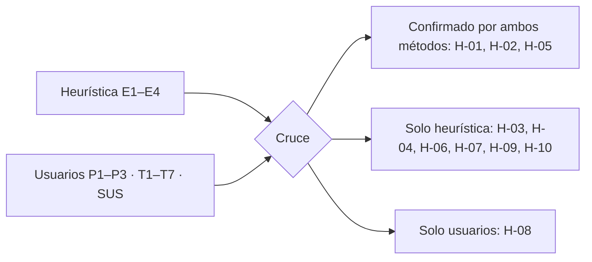

# Triangulación metodológica

> ⚠ **DATOS DE USUARIOS SIMULADOS (P1–P3).** Los valores de las sesiones son de ejemplo, coherentes con el comportamiento real del prototipo, pero **no fueron medidos con personas**. Reemplazarlos en `datos/fase3_participantes.json` y ejecutar `python herramientas/generar_fase3_4.py` antes de presentarlos como evidencia empírica.

Cruce entre la inspección analítica (4 evaluadores) y la prueba empírica (3 participantes).

| Hallazgo | Evidencia heurística | Evidencia de usuarios | Categoría | Severidad |
| --- | --- | --- | --- | --- |
| **H-01** Búsqueda sensible a tildes | 3/4 (Julio, Oscar, Cristian) | 2/3 (P1, P2) | **Confirmado por ambos métodos** | 4 · Crítico |
| **H-02** Producto con pocas unidades se agota recién al confirmar | 4/4 (Cristian, Matias, Julio, Oscar) | 3/3 (P1, P2, P3) | **Confirmado por ambos métodos** | 3 · Mayor |
| **H-03** El pedido confirmado no se encuentra desde «Mi pedido» | 2/4 (Matias, Oscar) | No observado | **Solo heurística** | 3 · Mayor |
| **H-04** Etiquetas de navegación inconsistentes | 3/4 (Oscar, Julio, Matias) | No observado | **Solo heurística** | 2 · Menor |
| **H-05** Falta información de pago, tiempo y lugar de retiro | 3/4 (Cristian, Matias, Oscar) | 2/3 (P1, P2) | **Confirmado por ambos métodos** | 2 · Menor |
| **H-06** Horas de retiro fijas y sin relación con la hora actual | 2/4 (Matias, Cristian) | No observado | **Solo heurística** | 2 · Menor |
| **H-07** Textos secundarios menores a 12 px | 2/4 (Julio, Oscar) | No observado | **Solo heurística** | 1 · Cosmético |
| **H-08** Agregar un producto lleva a «Mi pedido» sin avisar | No detectado | 2/3 (P1, P2) | **Solo usuarios** | 2 · Menor |
| **H-09** Límite de 9 unidades sin mensaje | 1/4 (Julio) | No observado | **Solo heurística** | 1 · Cosmético |
| **H-10** «Sanduche» sin tilde y distinto del nombre en las tareas | 2/4 (Julio, Oscar) | No observado | **Solo heurística** | 1 · Cosmético |

## Síntesis

- **Confirmados por ambos métodos:** 3 de 10 (30,0 %): H-01, H-02, H-05. Es la evidencia más fuerte.
- **Solo heurística:** 6 de 10: H-03, H-04, H-06, H-07, H-09, H-10. Las tareas no recorren esas pantallas o el defecto no impidió completar tareas.
- **Solo usuarios:** 1 de 10: H-08. Los evaluadores no anticiparon que cambiar de pantalla al agregar rompería el ritmo de armado.
- La tarea T7 convirtió el buscador, que no se había probado en el pilotaje, en el problema de mayor severidad (H-01).

Elaborado por: Matias Morales · Fecha: 18/11/2026
